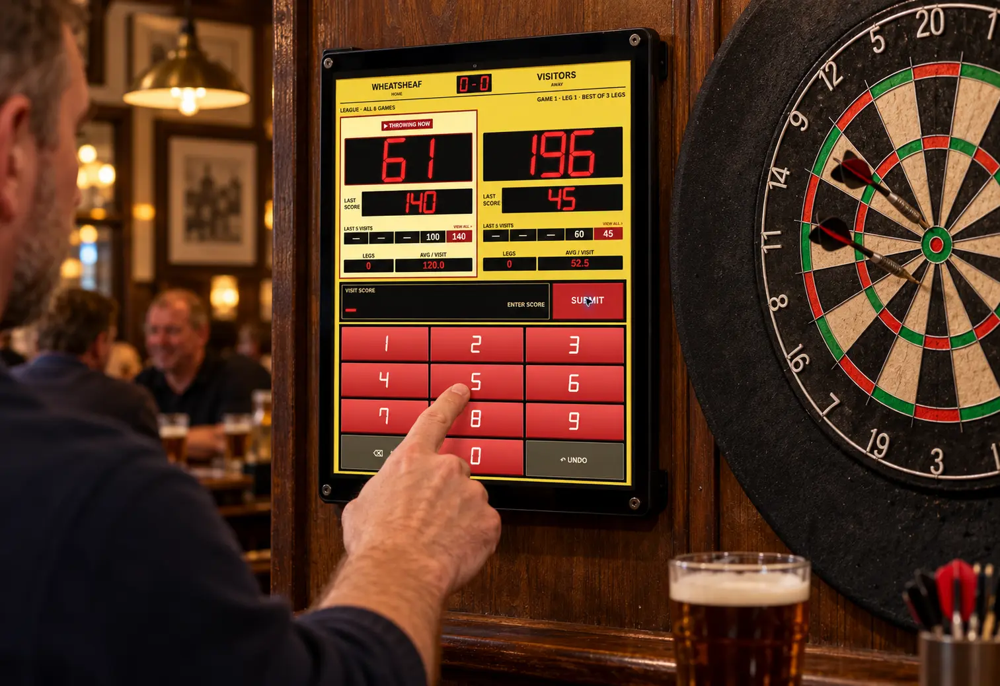

# Retro Darts Scorer

A free Progressive Web App for pub darts teams and leagues (MIT-licensed source). Retro display, straightforward score entry, and no adverts. No account is needed to score; signing in with Google is optional and backs your matches up to your own Google Drive. Install it from a supported browser on Android, iPhone, iPad, tablet or computer.

See the [V1 distribution decision](docs/DISTRIBUTION_DECISION.md) for the current platform scope and distribution history.

**[Use the scorer](https://retrodarts.com/)** · [Contact support](mailto:support@retrodarts.com)



*AI-generated promotional mock-up; not a photograph of a verified installation.*

## Start a match

1. Open the scorer and select **Start a match**.
2. Enter both team names, choose 301, 401 or 501, and set the fixture and leg formats.
3. Choose the bull-up winner, then enter each verified visit total and tap **Submit**. Enter **0** for a miss or invalid visit.

The default is eight games of 301, each best of three legs. **Play all** allows a drawn fixture; **Best of** stops once decided; **First to** uses a target number of wins. Each game has a new starter selection. Starters alternate between legs, with a fresh bull-up for a tied deciding leg.

## What it does

- Match history: open, share or download a finished match as a PDF, delete one, or tick several and delete them together.
- Cast to TV: a Chromecast opens `/tv/` and the scorer sends it scores as small messages, not video. The Google Cast app id is `CAST_APP_ID` in `index.html`; the Cast icon in the top bar and the Cast to TV buttons show in Chrome. Preview the TV page at `/tv/?demo`.
- Displays remaining scores, the latest score, five recent visits per team, leg and match scores, and points per visit.
- Shows paired visit-round tables for every leg, with both teams’ scores and remaining totals, highlighted checkouts, leg winners, visits and averages. Earlier games remain accessible in All visit scores.
- Opens the leg tables automatically at game end, with highest score and highest checkout per team and one button for the next game. Undo, PDF download and All visit scores sit behind More. A one-game match goes straight to the final result.
- Saves the current fixture on the device, including recorded visits across completed games.
- Offers a cumulative match PDF after each completed leg and a complete match report at fixture end. Reports include the overall result, each game's leg score and all recorded visit tables. Saved fixtures can be downloaded from Match history. Long legs continue across pages with repeated headings. Actual darts used are not recorded; leg summaries use visits and average points per visit.
- Supports home-screen installation, offline scoring after setup, optional full screen, keeping the screen on during a match, and light touch vibration where the browser supports them.
- **Share result** at full time and in Match history sends a plain-text match card (score, game results, top checkout, top score and 180s) through the phone's share sheet, for example to the team WhatsApp group; where sharing is not available it is copied.

## Scoring rules

The marker and checker verify the darts. The app accepts whole visit totals from **0 to 180**; it does **not** check whether a total is achievable or whether an opening or finishing dart was a double. An exact zero finishes the leg immediately. Overscoring or leaving one records a bust with no deduction. There are no double-in/out controls. Checkout hints are off by default; turned on in **Settings → Game settings**, the score box suggests a standard double-out finish from 170 down. They are only a suggestion: the app still accepts any total.

The average is **points per visit**, including the finishing visit; actual darts used are not entered. Agree the rules with your league before use. League-style defaults do not imply league approval or certification.

## Install and use offline

- Open the burger menu and choose **Install app**. Chromium browsers show their install prompt when available; otherwise the app provides the browser-specific next step.
- **iPhone / iPad:** open this page in Safari, tap **Share → Add to Home Screen**, and choose **Open as Web App** if offered.

Open the app once while online and check the menu for **Offline copy ready**. The app asks the browser to preserve its storage when a match starts. Browsers may decline, and device cleanup, uninstalling the browser, losing the device or using another browser/profile can still remove saved matches. Export the PDF if you need a separate copy.

## Saved matches and privacy

The app stores the current fixture in browser storage. Reopen it on the same device and browser profile to resume the last successfully saved action. Unsubmitted digits are not saved. Completed fixtures can be kept in local Match history; starting a new match replaces the active fixture.

If saving fails, scoring pauses with retry and PDF options. Keep the page open until you have saved or exported. Unreadable or structurally invalid fixtures detected during loading display a warning. Damaged optional Undo history is discarded where detected so the fixture can continue; stored-state validation is not exhaustive. Browser storage can still be cleared or evicted and is not a backup.

There is no application backend or advertising. Start a match is the only button on the front page; sign-in, Match history and Cast to TV are in Settings and the top bar; with no signal, or when Google cannot be reached, the app scores anyway. Matches are always saved on the device. Signing in backs up finished matches, theme and settings to a private app folder in the user's own Google Drive, and Google Analytics runs only if the user accepts it in the cookie banner. See the [privacy policy](https://retrodarts.com/privacy/).

## Themes

Four looks, all with the same layout and the embedded DSEG seven-segment digits; only the colours differ. Change them from the menu (⚙ → Themes).

- **Retro** (default): yellow panels, black LED windows, red digits, the One Eighty pub-scoreboard look.
- **Retro Black**: black cabinet, red digits.
- **Modern**: slate and green.
- **Classical Pub**: chalkboard, brass, pub-green keys and red LEDs.

## Current limitations

- Use **one scoring tab or window per browser profile**. Concurrent tabs can overwrite scores and clear an unfinished entry.
- Phones score upright (a phone on its side is asked to turn); tablets and larger screens adapt to either orientation. A tablet in landscape on the wall is the layout the app is designed around.
- Home-screen install and offline use depend on the browser. Device-local browser storage is best-effort, not a separate backup.
- PDF output transliterates accented characters where possible and replaces unsupported characters, including emoji, with `?`.
- Finished matches, theme and settings (checkout hints, keep screen on, vibration, default match) sync between devices through the user's own Google Drive; a match in progress stays on its device. Completed fixtures are archived locally; PDF reports are optional readable copies and are not automatically restored. Older saves cannot recover visits that were not retained at the time.

## Run locally or self-host

There is no app bundler or package installation. For development, serve this folder with a static server, for example:

```sh
python3 -m http.server 8000 --bind 127.0.0.1
```

Open `http://localhost:8000`. Production home-screen/offline support requires HTTPS. Cloudflare Pages Git builds run `node scripts/prepare-pages.cjs` and publish `dist/`; that script copies only the explicit public-file allowlist. See [architecture and hosting](docs/ARCHITECTURE.md). A service worker can cache an older build until an update has installed; avoid refreshing during an active match just to fetch an update.

## Development and checks

Use Node.js **22 or 24**. No npm dependencies are needed.

```sh
node scripts/check.cjs
```

This runs the scoring, install, offline, font, distribution, release-version, and layout checks. GitHub Actions runs it on pull requests and Cloudflare Pages runs it before publishing, both on Node 22 (`.node-version`). See [architecture](docs/ARCHITECTURE.md).

`node tests/fuzz.cjs [fixtures] [seed]` is an optional stress test of the scoring maths. It plays random fixtures (default 1,000) in every format, with busts, finishes and undos. After every action it recalculates scores, legs, games, averages, reports and the saved match from the visit log. A failure prints the seed so the run can be repeated.

This is an independently maintained personal project, provided as-is. It does not represent or carry endorsement from the maintainer's employer. Support is best effort through GitHub; no support SLA is offered.

## Licence and credits

The app code is [MIT licensed](LICENSE). Bundled DSEG fonts by [keshikan](https://github.com/keshikan/DSEG) retain their separate [SIL Open Font License 1.1](third-party/DSEG-LICENSE.txt), including when embedded in the HTML files. Bundled [Barlow Condensed](https://github.com/jpt/barlow) by Jeremy Tribby is also under the SIL Open Font License 1.1 ([licence text](third-party/BARLOW-CONDENSED-LICENSE.txt)). See [asset credits](ASSETS.md) for the dartboard mark and promotional image.
